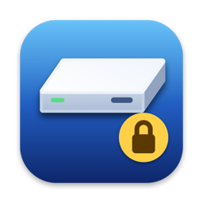
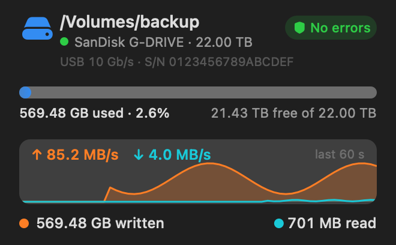
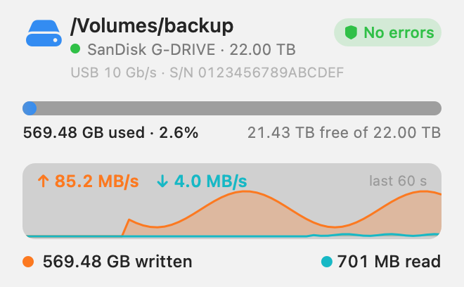
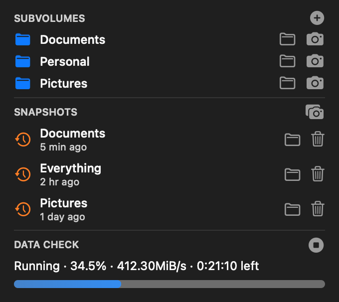

# G-Drive



A macOS menu bar app for an external drive that is **Btrfs on LUKS2**. macOS cannot read that combination, so G-Drive drives [anylinuxfs](https://github.com/nohajc/anylinuxfs) (a small Linux VM) for you: plug the drive in, start the app, type the passphrase, and the volume is mounted, writable, in Finder.

It was written for a SanDisk Professional G-DRIVE 22 TB, but nothing in it is specific to that model: the drive and volume names are settings.

## What it does

- **One-click unlock and mount.** Finds the drive, asks for the LUKS passphrase (optionally remembers it in the Keychain), mounts the volume, opens Finder.
- **One-click eject.** "Eject Drive and Quit" unmounts, stops the VM, ejects the drive and quits, leaving no `anylinuxfs`, `vmnet-helper` or `gvproxy` process behind.
- **Keep the drive awake.** Many USB drives power themselves off after a minute or so of idle, which kills a mounted volume. While mounted, the app writes and syncs a few bytes every 20 seconds so the drive never idles.
- **Live dashboard** at the top of the menu: used/free space bar, a 60-second read/write throughput graph with the current rates, a health badge (`btrfs device stats`), and the bytes written and read.
- **Btrfs card:** subvolumes (open, create, snapshot one) and snapshots (open, delete, snapshot everything) as rows with buttons, plus a scrub (full checksum check of all data) with an estimated progress bar and the result of the last run.
- **LUKS header backup and verify.** Saves the LUKS header to a file you choose and compares a saved file with the drive later.
- **Recovers from a dropped drive.** If the drive comes back under a new disk name, the dead mount is cleared and the app asks again.
- **About** shows the app and anylinuxfs versions and tells you when a newer anylinuxfs release exists.

<p>
  
  
  
</p>

*The screenshots are the two cards rendered with sample numbers.*

## Requirements

- Apple Silicon Mac, macOS 13 or newer
- Xcode Command Line Tools (`xcode-select --install`), for `swift`
- anylinuxfs:
  ```bash
  brew tap nohajc/anylinuxfs
  brew trust nohajc/anylinuxfs
  brew install anylinuxfs
  ```
- An admin account: reading the raw disk needs `sudo`, which the app requests through a native password dialog.

## Build and install

```bash
git clone https://github.com/shatyrko/g-drive.git
cd g-drive
scripts/build.sh
open /Applications/GDrive.app
```

`scripts/build.sh` builds with SwiftPM, signs the app ad hoc (no Apple developer account, no notarization) and installs it to `/Applications` (or `~/Applications` if that is not writable). It has no Dock icon, only the menu bar icon.

## Point it at your drive

Defaults: media name `G-DRIVE`, Btrfs label `backup` (so `/Volumes/backup`).

```bash
diskutil info /dev/diskN | grep "Media Name"          # the name macOS reports for your enclosure
defaults write local.g-drive diskName "Your Drive Name"
defaults write local.g-drive volumeName "your-btrfs-label"
```

Restart the app afterwards. The keep-alive interval and the anylinuxfs path are constants in `Sources/GDrive/Support.swift`.

## Menu

| State | Items |
| --- | --- |
| Drive not plugged in | status only |
| Locked | Unlock and Mount…, LUKS Header, Eject Drive |
| Mounted | dashboard, Open in Finder, Lock, Lock and Eject Drive, Btrfs, Keep Drive Awake with its LUKS Header submenu, About, Eject Drive and Quit |

Flow: plug the drive in, start the app. It asks for the passphrase at once, mounts the volume and opens Finder. While data moves, the menu bar icon shows ↑ (writing), ↓ (reading) or ↕.

## How it works

- The drive is found by its media name among external physical disks; its first partition is passed to anylinuxfs.
- **Mount:** `sudo -A --preserve-env=ALFS_PASSPHRASE anylinuxfs mount -w false --ignore-permissions /dev/diskXsY`. The passphrase travels in the environment variable `ALFS_PASSPHRASE`, never on a command line. `sudo` asks for the Mac password through a small askpass helper (a native dialog), written to `~/Library/Application Support/G-Drive/`. `--ignore-permissions` is needed because the Btrfs root directory is owned by root.
- **Unmount:** `anylinuxfs unmount --wait-for-vm`; **eject:** `diskutil eject`.
- **Btrfs tools** run `btrfs` inside the VM with `anylinuxfs vm exec`, which needs a terminal, so the app wraps it in `script`.
- **Scrub:** the VM's root file system is read-only, so btrfs cannot record scrub progress and `btrfs scrub status` shows nothing useful. The app runs `btrfs scrub start -B` in the foreground, tells that a scrub is running from the VM's process list, and estimates progress from the bytes macOS counts as read from the drive against the "Total to scrub" figure. The estimate counts any other reads too, hence the "≈".
- **LUKS header backup:** reads the first 32 MiB of the partition with `sudo dd`, finds the real header size in the LUKS metadata (LUKS1 and LUKS2) and saves just that, mode 0600. It is the same content `cryptsetup luksHeaderBackup` writes, so `cryptsetup luksHeaderRestore` accepts it.
- **Snapshots** go to `.snapshots/<time>/` (`_root` for the top level, one entry per subvolume) or `.snapshots/<time>-<name>/` for a single subvolume. A snapshot of the top level alone would hold only empty folders where subvolumes are, so the whole-volume snapshot covers each subvolume too.
- **Quit** unmounts and stops the VM. Killing the app (`pkill GDrive`) leaves the mount and VM running on purpose, so the app can restart without unmounting.
- Automatic actions are logged to `~/Library/Logs/G-Drive.log`; anylinuxfs keeps its own logs in `~/Library/Logs/anylinuxfs-*.log`.

## Security notes

- A header backup plus an old passphrase unlocks the drive. Keep the file private, and off the drive itself (the app refuses to save it there).
- "Remember in Keychain" stores the passphrase in your login keychain (item `g-drive.luks`). Anyone logged in as you with the keychain unlocked can then open the drive. It is off unless you tick it; "Forget Saved Passphrase" removes it.
- The Mac password is only ever typed into the system dialog that `sudo` shows; the app does not see or store it.
- The app's only network access is the update check against `api.github.com` (at start and every 12 hours). anylinuxfs talks to its VM over a local virtual network.

## Troubleshooting

- **A firewall (Little Snitch, LuLu, …) asks about the app on every start.** The app is signed ad hoc, so every build has a new signature and a firewall sees a new program each time. Sign with a stable local certificate to avoid it, or allow the one connection (`api.github.com`).
- **`-600` when relaunching right after `pkill`.** The old instance was still exiting; run `open` again.
- **"Cannot probe /dev/diskNsM … Insufficient permissions".** The mount was started without `sudo`; use the app, which asks for it.

## Limitations

- Built and tested for one drive on one Mac (Apple Silicon, macOS 26). Treat it as a starting point and try it on a drive that holds nothing you cannot lose first: it handles encrypted data and runs `sudo`.
- Keep-alive only works while the volume is mounted, and it cannot stop the Mac from sleeping.
- Reads and writes go through an NFS share served by the VM, so small-file performance is lower than a native disk.

## Licenses and credits

- G-Drive is released under the [MIT License](LICENSE).
- It runs [anylinuxfs](https://github.com/nohajc/anylinuxfs) (GPL-3.0) as a separate program that you install yourself; no anylinuxfs code is included or linked.
- The small glyphs in the menu are Apple SF Symbols, used inside the app's interface as Apple's terms allow. The app icon is an original drawing (`scripts/make-icon.swift`) and does not use SF Symbols.
- Not affiliated with or endorsed by SanDisk, Western Digital, Apple or the anylinuxfs project. Product names are used only to say what the tool was tested with.
